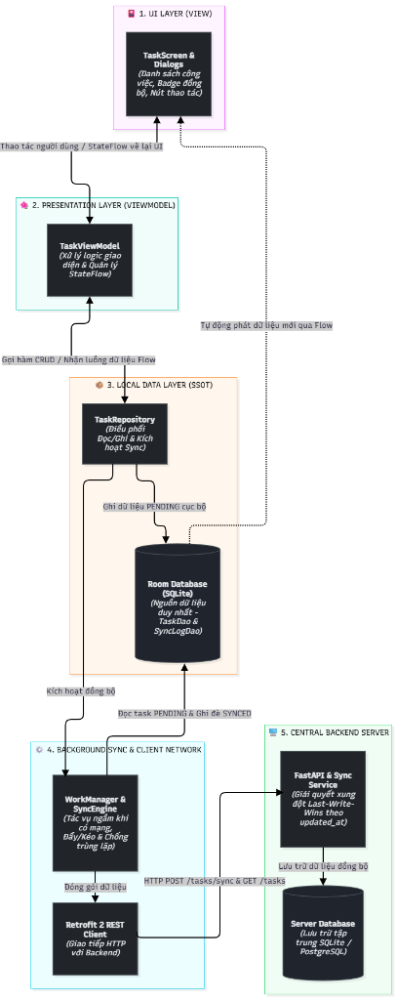
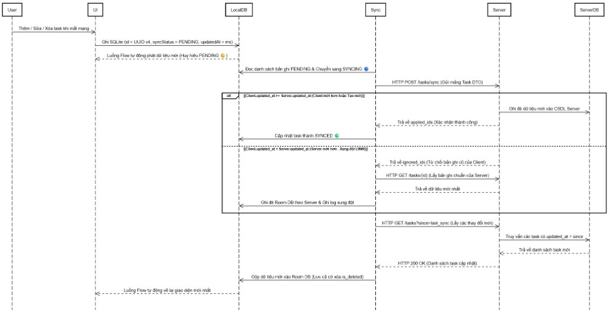

# 📱 BÁO CÁO KỸ THUẬT & TÀI LIỆU DỰ ÁN GIỮA KỲ
## ỨNG DỤNG ANDROID OFFLINE-FIRST VỚI FASTAPI BACKEND

> **Môn học:** Phát triển Ứng dụng Di động (Mobile Programming)  
> **Đề tài 1:** Xây dựng ứng dụng Android hỗ trợ hoạt động ngoại tuyến và đồng bộ dữ liệu tự động  
> **Kiến trúc trọng tâm:** Offline-First Architecture • Single Source of Truth (SSOT) • Two-Way Sync Engine • Last-Write-Wins (LWW)  
> **Nền tảng công nghệ:** Android (Kotlin, Jetpack Compose, Room Database, WorkManager, Retrofit 2) & Backend (Python 3.12, FastAPI, SQLAlchemy 2.0, SQLite)

---

## ⚡ KHỞI CHẠY NHANH BUỔI DEMO (1-CLICK)

Để phục vụ giảng viên chấm điểm thực nghiệm nhanh nhất:
1. **Trên máy tính:** Bấm đúp chuột vào file **`CHAY_DEMO.bat`** tại thư mục gốc:
   * Tự động khởi động máy chủ FastAPI tại cổng `8000`.
   * Tự động thông cổng qua USB (`adb reverse tcp:8000 tcp:8000`).
   * Tự động mở trình duyệt web hiển thị trang **Swagger UI** tại `http://localhost:8000/docs`.
2. **Trên điện thoại / Máy ảo:** Mở icon ứng dụng Todo lên và thao tác thêm/sửa/xóa trực tiếp.

---

## 📑 MỤC LỤC
1. [Tổng quan Kiến trúc Hệ thống](#1-tổng-quan-kiến-trúc-hệ-thống)
2. [Quy ước Dữ liệu Dùng chung (Data Contract)](#2-quy-ước-dữ-liệu-dùng-chung-data-contract)
3. [Thiết kế Backend API (Python FastAPI)](#3-thiết-kế-backend-api-python-fastapi)
4. [Cấu trúc Thư mục Dự án](#4-cấu-trúc-thư-mục-dự-án)
5. [Phân chia Nhiệm vụ & Danh mục Bàn giao (Deliverables D1 - D8)](#5-phân-chia-nhiệm-vụ--danh-mục-bàn-giao-deliverables-d1---d8)
6. [Kịch bản Kiểm thử Thực nghiệm (Test Cases TC01 - TC09)](#6-kịch-bản-kiểm-thử-thực-nghiệm-test-cases-tc01---tc09)
7. [Hướng dẫn Cài đặt & Chạy Thực nghiệm](#7-hướng-dẫn-cài-đặt--chạy-thực-nghiệm)

---

## 1. TỔNG QUAN KIẾN TRÚC HỆ THỐNG

Dự án áp dụng chặt chẽ triết lý **Offline-First Architecture**:
- Cơ sở dữ liệu cục bộ (**Room Database**) trên thiết bị đóng vai trò là Nguồn chân lý duy nhất (**Single Source of Truth - SSOT**) mà giao diện người dùng (UI) quan sát và hiển thị.
- Mọi thao tác Thêm / Sửa / Xóa từ người dùng đều được ghi nhận trực tiếp vào Room DB ngay lập tức mà **không cần chờ kết nối Internet** (độ trễ $< 10\text{ ms}$).
- Tiến trình nền (**WorkManager - SyncWorker**) chịu trách nhiệm đồng bộ hai chiều (Two-Way Sync) giữa Room DB và FastAPI Server khi đáp ứng đủ điều kiện về kết nối mạng (`NetworkType.CONNECTED`).

### 1.1. Sơ đồ Luồng Dữ liệu Kiến trúc (Data Flowchart)

<p align="center">
  
  <br>
  <em>Hình 1.1: Sơ đồ kiến trúc phân tầng 5 lớp và luồng dữ liệu một chiều (SSOT)</em>
</p>

### 1.2. Sơ đồ Trình tự Đồng bộ Hai chiều (Sync Sequence Diagram)

<p align="center">
  
  <br>
  <em>Hình 1.2: Sơ đồ trình tự tương tác hai chiều và phân giải xung đột Last-Write-Wins (LWW)</em>
</p>

---

## 2. QUY ƯỚC DỮ LIỆU DÙNG CHUNG (DATA CONTRACT)

Để quá trình đồng bộ hai chiều diễn ra an toàn, không xảy ra xung đột khóa chính khi tạo mới ngoại tuyến, hệ thống thống nhất cấu trúc dữ liệu chung:

### 2.1. Bảng Đặc tả Thuộc tính Bản ghi (Task Schema)

| Tên trường | Kiểu dữ liệu | Phạm vi | Mô tả chi tiết |
| :--- | :--- | :--- | :--- |
| `id` | `VARCHAR(36)` | Client & Server | Khóa chính dạng chuỗi UUID v4 do Client sinh ngẫu nhiên khi tạo bản ghi mới (triệt tiêu va chạm ID khi Offline). |
| `title` | `VARCHAR(255)` | Client & Server | Tiêu đề công việc (bắt buộc, không để trống). |
| `is_completed` | `BOOLEAN` | Client & Server | Trạng thái hoàn thành (`true`: đã xong, `false`: chưa xong). Mặc định `false`. |
| `is_deleted` | `BOOLEAN` | Client & Server | Cờ xóa logic (**Soft Delete / Tombstone**). Không xóa vật lý để Server và các thiết bị khác nhận diện lệnh xóa. |
| `created_at` | `BIGINT` | Client & Server | Mốc thời gian tạo bản ghi ban đầu (Unix epoch ms). |
| `updated_at` | `BIGINT` | Client & Server | Mốc thời gian chỉnh sửa mới nhất (Unix epoch ms) để phân giải xung đột (**Last-Write-Wins**). |
| `syncStatus` | `Enum` | **Chỉ có ở Room DB** | Trạng thái đồng bộ cục bộ: `SYNCED`, `PENDING`, `SYNCING`, `FAILED`. |
| `lastError` | `TEXT` | **Chỉ có ở Room DB** | Chuỗi thông báo lỗi kỹ thuật nếu lần đồng bộ gần nhất thất bại. |

---

## 3. THIẾT KẾ BACKEND API (PYTHON FASTAPI)

FastAPI đóng vai trò là Server trung tâm, cung cấp các RESTful API phục vụ đồng bộ lô (Batch Sync) và truy vấn dữ liệu tăng dần (Incremental Fetch):

| Phương thức | Endpoint | Chức năng chính | Ghi chú |
| :--- | :--- | :--- | :--- |
| `GET` | `/health` | Kiểm tra tình trạng hoạt động của Server | Healthcheck trả về server time |
| `GET` | `/tasks` | Tải danh sách công việc | Hỗ trợ Query Param `since` để lấy dữ liệu tăng dần |
| `POST` | `/tasks/sync` | API Đồng bộ lô (Batch Sync & LWW) | Đẩy lô 100 task lên, phân loại `applied_ids` và `ignored_ids` |
| `POST` | `/tasks` | Tạo mới task đơn lẻ | Dùng để test trực tiếp trên Swagger UI |
| `PUT` | `/tasks/{id}` | Cập nhật task đơn lẻ | Dùng để giả lập thiết bị thứ hai tạo xung đột |
| `DELETE` | `/tasks/{id}` | Xóa logic task | Gán `is_deleted = true` |

---

## 4. CẤU TRÚC THƯ MỤC DỰ ÁN

```text
Midterm-Mobile/
├── CHAY_DEMO.bat                    # Script 1-Click khởi chạy toàn bộ hệ thống demo
├── android/                         # Mã nguồn ứng dụng Android (Kotlin + Jetpack Compose)
│   ├── app/
│   │   ├── src/main/java/com/example/offlinefirsttodo/
│   │   │   ├── data/
│   │   │   │   ├── local/           # Room Database, TaskEntity, TaskDao, SyncLogEntity
│   │   │   │   ├── remote/          # Retrofit API Interface, DTOs, ApiProvider
│   │   │   │   └── repository/      # TaskRepository (Offline-First, Monotonic Timestamp)
│   │   │   ├── sync/                # SyncEngine (Push/Pull, CAS), SyncWorker, SyncScheduler
│   │   │   ├── ui/                  # Compose TaskScreen, TaskViewModel, Dialogs
│   │   │   └── util/                # ConnectivityObserver, AppPrefs, TimeFormat
│   │   └── build.gradle.kts
│   └── README.md                    # Hướng dẫn chi tiết cho ứng dụng Android
│
├── backend/                         # Mã nguồn Python FastAPI Server
│   ├── app/
│   │   ├── models/                  # SQLAlchemy ORM Models (Task)
│   │   ├── schemas/                 # Pydantic Schemas (Request/Response)
│   │   ├── crud/                    # Data Access Layer
│   │   ├── services/                # sync_service.py (Thuật toán LWW, Batch Sync)
│   │   ├── routers/                 # REST API Endpoints
│   │   └── main.py                  # Điểm khởi tạo FastAPI app
│   ├── tests/                       # Bộ kiểm thử tự động (pytest)
│   ├── sample_data.json             # Dữ liệu mẫu khởi tạo (Deliverable D4)
│   ├── seed.py                      # Script tự động nạp dữ liệu mẫu
│   ├── tasks.db                     # Cơ sở dữ liệu SQLite
│   ├── requirements.txt             # Danh sách thư viện Python
│   └── README.md                    # Hướng dẫn chi tiết cho Backend
│
└── docs/                            # Tài liệu bàn giao & Báo cáo kỹ thuật
    ├── images/                      # Hình ảnh (Sơ đồ Use Case, Architecture, Sequence, ERD)
    ├── D4_API_Documentation.md      # Tài liệu đặc tả RESTful API
    └── D5_Sync_Algorithm.md         # Thuật toán đồng bộ hai chiều & phân giải LWW
```

---

## 5. PHÂN CHIA NHIỆM VỤ & DANH MỤC BÀN GIAO (DELIVERABLES D1 - D8)

### 5.1. Bảng Trạng Thái Hoàn Thành Các Deliverables

| Mã | Hạng mục Bàn giao | Trạng thái thực tế |
| :-: | :--- | :---: |
| **D1** | Báo cáo nghiên cứu lý thuyết (Offline-First, MVVM, Room, Retrofit, WorkManager, LWW) | ✅ **Đã hoàn thành** (Chương 1 Báo cáo PDF) |
| **D2** | Tài liệu phân tích và thiết kế (FR/NFR, Use Case, Kiến trúc 5 tầng, Sequence, ERD) | ✅ **Đã hoàn thành** (Chương 2 Báo cáo PDF) |
| **D3** | Mã nguồn ứng dụng Android (Kotlin, Jetpack Compose, Room, WorkManager, Retrofit) | ✅ **Đã hoàn thành** (Thư mục `android/`) |
| **D4** | Mã nguồn máy chủ và API (FastAPI, CRUD, LWW Sync, Tài liệu API, Dữ liệu mẫu `sample_data.json`) | ✅ **Đã hoàn thành** (Thư mục `backend/`, `seed.py`) |
| **D5** | Mô-đun đồng bộ & Thuật toán xử lý xung đột (Flowchart, Monotonic, Soft Delete, CAS) | ✅ **Đã hoàn thành** (Chương 3 Báo cáo PDF) |
| **D6** | Bộ kiểm thử và kết quả kiểm thử (Bảng TC01-TC09, ảnh chụp app thực tế) | ✅ **Đã hoàn thành** (Chương 4 Báo cáo PDF) |
| **D7** | Báo cáo thực nghiệm và đánh giá hiệu năng (Đo lô 10, 50, 100 bản ghi, ưu/khuyết điểm) | ✅ **Đã hoàn thành** (Chương 5 Báo cáo PDF) |
| **D8** | Sản phẩm trình diễn & Hướng dẫn (File APK, Video demo, Script `CHAY_DEMO.bat`) | ✅ **Đã hoàn thành** (File APK + Script demo) |

---

## 6. KỊCH BẢN KIỂM THỬ THỰC NGHIỆM (TEST CASES TC01 - TC09)

| Mã TC | Kịch bản kiểm thử | Thao tác thực hiện | Kết quả thực tế | Trạng thái |
| :---: | :--- | :--- | :--- | :---: |
| **TC01** | Tạo việc khi có mạng | Bật mạng $\rightarrow$ Thêm task mới | Lưu vào Room DB, đẩy lên Server thành công (`SYNCED` 🟢). | **PASS** |
| **TC02** | Thao tác khi mất mạng | Bật Chế độ máy bay $\rightarrow$ Thêm, sửa task | Thao tác phản hồi tức thì ($0\text{ ms}$), hiển thị nhãn `PENDING` 🟡. | **PASS** |
| **TC03** | Có mạng lại, tự đồng bộ | Tắt Chế độ máy bay | WorkManager tự phát hiện mạng, đẩy task lên và đổi sang `SYNCED` 🟢. | **PASS** |
| **TC04** | Gián đoạn khi đang sync | Đang sync $\rightarrow$ Vuốt tắt app $\rightarrow$ Mở lại | Bản ghi kẹt tự khôi phục về `PENDING`, không mất mát dữ liệu. | **PASS** |
| **TC05** | Máy chủ tạm không phản hồi | Tắt Server $\rightarrow$ Thao tác $\rightarrow$ Bấm Sync | App không crash, task chuyển sang `FAILED` 🔴. Khi bật lại Server tự retry. | **PASS** |
| **TC06** | Tính lặp an toàn (Idempotency) | Bấm "Đồng bộ ngay" liên tục nhiều lần | Server nhận diện cùng timestamp, không sinh bản ghi trùng lặp. | **PASS** |
| **TC07** | Hai máy cùng sửa (Xung đột) | 2 máy offline cùng sửa $\rightarrow$ Lần lượt bật mạng | Hội tụ về phiên bản sửa sau (LWW) trên cả 2 máy và máy chủ. | **PASS** |
| **TC08** | Xóa khi mất mạng (Soft Delete) | Offline $\rightarrow$ Nhấn Xóa task $\rightarrow$ Bật mạng | Task ẩn tức thì, cờ `is_deleted = true` gửi lên server, không bị tải ngược. | **PASS** |
| **TC09** | Đo tải đồng bộ nhiều bản ghi | Tạo lô 50 – 100 task offline $\rightarrow$ Bật mạng | 100% bản ghi thành công, đo thời gian chi tiết qua **Nhật ký đồng bộ**. | **PASS** |

---

## 7. HƯỚNG DẪN CÀI ĐẶT & CHẠY THỰC NGHIỆM

### 7.1. Chạy Backend (Python FastAPI)
```powershell
cd backend
python -m venv venv
.\venv\Scripts\Activate.ps1
pip install -r requirements.txt
uvicorn app.main:app --host 0.0.0.0 --port 8000 --reload
```
* **Swagger UI Docs:** [http://localhost:8000/docs](http://localhost:8000/docs)
* **Chạy bộ kiểm thử tự động:** `.\venv\Scripts\python.exe -m pytest -v`

### 7.2. Chạy Ứng Dụng Android
1. Mở thư mục `android/` bằng **Android Studio**.
2. Chờ Gradle đồng bộ thư viện và bấm **Run (Shift + F10)**.
3. Cấu hình Server (Menu **⋮ > Cấu hình server**):
   * Dùng Emulator: `http://10.0.2.2:8000/`
   * Dùng Máy thật cắm cáp USB: `http://localhost:8000/` (kết hợp `adb reverse tcp:8000 tcp:8000`).
